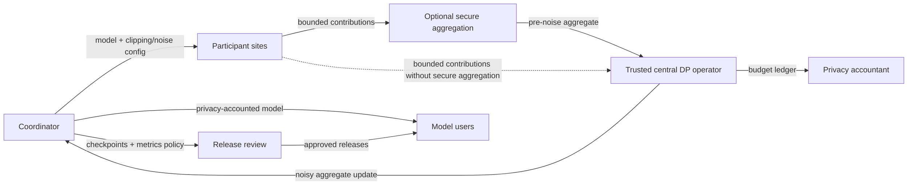

# FL + Differential Privacy

## Decision framing

| Field | Scope |
| --- | --- |
| Protected asset | The contribution of a declared record, person, or participant to released models and metrics. |
| Adversary | Recipients of DP releases; the central DP operator remains trusted with pre-noise values in this design. |
| Allowed output | Accounted models and metrics under the declared epsilon, delta, adjacency, and release policy. See [allowed output](../start-here/glossary.md#allowed-output). |
| Leakage surface | Pre-noise updates, non-private checkpoints, logs, tuning results, and releases omitted from accounting. See [leakage](../start-here/glossary.md#leakage). |
| Assumptions | Clipping, sampling, noise, privacy unit, and accounting match execution; see the assumption review below. |
| Non-goals | Poisoning prevention, protection before the DP mechanism, or acceptable utility for every site. |

--8<-- "decision-guidance.md"

## Goal

Train a shared model while bounding the influence of a privacy unit on the released model.

## Actors

Participants, training coordinator, a trusted central DP operator, model owner, privacy accountant, auditors, and model users. In the diagram, the consortium appoints the central DP operator as the sole recipient of pre-noise aggregates. A coordinator who also performs that role has the same trust obligations.

## Data Flow

On small screens, scroll the diagram horizontally to read the labels.

## Trust Boundaries

| Boundary | What crosses | Who can see it | Risk |
| --- | --- | --- | --- |
| Coordinator to sites | Model, code, DP parameters | Sites | Misconfigured clipping or noise |
| Sites to DP operator | Secure aggregate, or individual site contributions if secure aggregation is omitted | Trusted central DP operator | Pre-noise values and operator logs fall inside the trusted boundary |
| DP mechanism to accountant | Privacy events | Privacy accountant | Incorrect composition accounting |
| Coordinator to release review | Checkpoints, metrics, model candidates | Reviewers | Unaccounted releases can bypass DP claim |
| Coordinator to users | Final model | Model users | Memorization if DP assumptions fail |

## Assumptions

- The privacy unit is defined before training.
- Clipping, sampling, and accounting match the actual training process.
- Every release is included in composition accounting.
- Utility evaluation and any selection that uses private data follow the budget and release policy.

### Match clipping and accounting to the privacy unit

| Unit and adjacency | What to bound |
| --- | --- |
| One site joins or leaves | Clip the full contribution of each site once per round. Calibrate noise to the bound for the actual aggregation rule and account for site participation over all rounds. |
| One patient joins or leaves | Bound the total influence of that patient's records. For example, where each patient belongs to one site, use a per-step mechanism with a clipped per-patient contribution and an accountant for the implemented patient sampling and releases. If patients can appear at several sites, enforce a cross-site contribution bound or account for their combined participation. |

Document the sensitivity of the actual mechanism, including any weighting or normalization. Clipping a site update does not establish a patient-level guarantee by itself. Use public or proxy data to tune, or account for private model selection and diagnostics when they influence what is released. See [NIST SP 800-226](https://doi.org/10.6028/NIST.SP.800-226). *(Evidence: Literature-backed. Source quality: Primary / official.)*

### If no operator can see the pre-noise aggregate

Consider distributed DP, where sites contribute calibrated noise before secure aggregation so the coordinator receives only a noisy sum. Validate the noise that remains after the assumed dropouts and collusion, as well as quantization and the privacy accounting. Central DP applied after the coordinator sees the exact sum cannot protect that sum from the coordinator. See [Kairouz, Liu, and Steinke (ICML 2021)](https://proceedings.mlr.press/v139/kairouz21a.html). *(Evidence: Literature-backed. Source quality: Peer-reviewed / academic.)*

## Assumption Review

| Assumption | How to validate | If it fails |
| --- | --- | --- |
| Privacy unit is stable | Write the unit in the training spec and review neighboring datasets | The DP claim may protect the wrong person, device, site, or event |
| Accounting matches implementation | Reconcile run logs, sampling, clipping, and releases with the accountant | Epsilon/delta no longer describe the actual release |
| Tuning is accounted for | Track failed runs, candidate models, and auxiliary metrics | Utility pressure can spend privacy budget invisibly |
| Subgroup utility is acceptable | Evaluate sites and rare groups before release | A formally private model may be unusable for the people who need it |

## PET Stack

Federated learning, DP-SGD or noisy aggregate updates, privacy accounting, optional secure aggregation, and model auditing.

## Common PET Combinations

| Add | Use when | New risk |
| --- | --- | --- |
| Secure aggregation | Coordinator should not see individual updates before DP noise | Harder debugging and poisoning detection |
| Robust aggregation | Malicious or compromised sites are plausible | May conflict with DP clipping and secure aggregation |
| Confidential training | Training infrastructure is outside the main trust boundary | Attestation and hardware trust become part of the claim |
| Release governance | Multiple models, metrics, or synthetic artifacts are emitted | Requires a complete release ledger |

## Does not protect

- Poorly defined privacy units.
- Unaccounted releases or repeated experiments.
- Poisoning by malicious participants.
- Utility harm to underrepresented sites.
- Logs or checkpoints outside the DP mechanism.

Out of scope unless explicitly added: poisoning by participants, leakage before
the DP mechanism, side channels from local training, and downstream misuse of the
released model.

## Deployment Notes

Keep a budget ledger, bind DP parameters to training runs, and document failed tuning attempts when they consume privacy budget.

## Tradeoffs

DP provides a formal output guarantee, but it can reduce utility and make training harder to tune.

## Failure modes

Arbitrary epsilon choices, untracked composition, clipping that destroys utility, non-private checkpoints, and claims that omit the privacy unit.

## Evaluation Checklist

- What is the privacy unit?
- What epsilon/delta and accounting method are used?
- Are all releases and tuning runs accounted for?
- Does utility hold for small sites and subgroups?
- Are checkpoints, logs, and metrics covered by release policy?

## References

- Dwork and Roth, [*The Algorithmic Foundations of Differential Privacy*](https://www.cis.upenn.edu/~aaroth/Papers/privacybook.pdf), 2014.
- NIST, [*Guidelines for Evaluating Differential Privacy Guarantees*](https://doi.org/10.6028/NIST.SP.800-226), SP 800-226, 2025.
