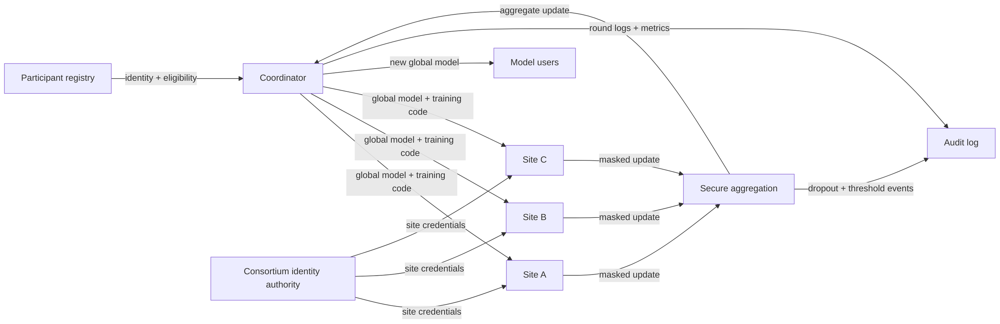

# FL + Secure Aggregation

## Decision framing

| Field | Scope |
| --- | --- |
| Protected asset | Individual participant updates before aggregation. |
| Adversary | A coordinator and sites that follow the protocol but pool what they observe, within the bounds described below. |
| Allowed output | Aggregate updates to the coordinator; approved models and metrics to downstream users. See [allowed output](../start-here/glossary.md#allowed-output). |
| Leakage surface | Small-round aggregates, participation and dropout metadata, logs, and final models. See [leakage](../start-here/glossary.md#leakage). |
| Assumptions | Authenticated participants, reviewed training code, correct key setup, and protocol-specific dropout and collusion thresholds. |
| Non-goals | Poisoning resistance, formal privacy of the aggregate or model, or security of compromised sites. |

--8<-- "decision-guidance.md"

## Goal

Train a shared model while hiding individual participant updates from the coordinator.

## Actors

Participants, coordinator, model owner, secure-aggregation service, auditors, and downstream model users.

## Data Flow

On small screens, scroll the diagram horizontally to read the labels.

## Trust Boundaries

| Boundary | What crosses | Who can see it | Risk |
| --- | --- | --- | --- |
| Coordinator to sites | Training code, model version, round instructions | Site operators, coordinator | An active coordinator can send inconsistent models and undermine update privacy even when the sum is securely computed |
| Site to aggregation | Masked updates and metadata | Aggregation service | Update leakage if threshold/key assumptions fail |
| Aggregation to coordinator | Aggregate update | Coordinator | Small rounds can expose participants |
| Coordinator to users | Final model | Model users | Memorization and membership inference |
| System to logs | Metrics, errors, round metadata | Operators, auditors | Logs can reveal participant behavior |

## Assumptions

- Enough participants complete each round to satisfy secure-aggregation thresholds.
- The consortium identity authority enrolls sites, binds public keys to site identities, and handles credential rotation and revocation. Each site generates and keeps its own private keys, including fresh round secrets as required by the protocol.
- Local training code is reviewed and versioned.
- For example, with the passive variant in [Bonawitz et al. (CCS 2017), §6.1](https://doi.org/10.1145/3133956.3133982), five registered sites and threshold four allow at most one dropout per round. Cap collusion at the coordinator plus one passive site. At least three included updates then remain unknown to the coalition before it sees the sum. The proof protects the protocol transcript beyond what the sum and the coalition's own inputs reveal. This configuration illustrates a design choice, and other protocols have different bounds.

!!! warning "If the coordinator can deviate"
    An actively malicious orchestrator can send different models to different sites, defeating update confidentiality at the training layer even if the sum is computed correctly. [Pasquini, Francati, and Ateniese (CCS 2022)](https://arxiv.org/abs/2111.07380) demonstrates this in studied FL configurations. Choose an actively secure aggregation protocol for the stated coalition and separately enforce a common authenticated round configuration. Before contributing, sites must verify agreement on the round ID, roster, model and training configuration through a channel the coordinator cannot equivocate over. Abort on disagreement. A signature from the coordinator alone cannot establish agreement across sites.

*(Evidence: Literature-backed. Source quality: Peer-reviewed / academic. The cited work covers the aggregation protocol and model-consistency threat respectively.)*

## Assumption Review

| Assumption | How to validate | If it fails |
| --- | --- | --- |
| Round threshold is large enough | Simulate dropouts and small-site participation | Aggregate updates can expose a site or force skipped rounds |
| Participant identity is reliable | Bind sites to keys, certificates, and round eligibility | A fake or compromised participant can poison or observe protocol behavior |
| Every site receives the same approved training task | Verify cross-site agreement on round ID, roster, model digest, and training configuration before contributing | A malicious coordinator can undermine privacy even if aggregation succeeds |
| Logs are minimized | Review round metadata, errors, and support bundles | Metadata can reveal participation, timing, or site behavior |

## PET Stack

Federated learning, secure aggregation, participant authentication, optional DP, robust aggregation, and model auditing.

## Common PET Combinations

| Add | Use when | New risk |
| --- | --- | --- |
| [Differential privacy](../start-here/glossary.md#differential-privacy) | The released model needs record-level or patient-level contribution bounds | Utility loss and accounting complexity |
| Robust aggregation | Participants may be malicious or compromised | Harder to combine with hidden individual updates |
| TEEs for orchestration | Coordinator code should be constrained by attestation | Hardware trust and side-channel assumptions |
| Output review | Final model or metrics may leak membership | Requires release gates and model-audit ownership |

## Does not protect

- Poisoned updates by malicious participants.
- Leakage from the final model.
- Weak local security at participant sites.
- Small-round inference.
- Debug logs that expose update metadata.

Out of scope unless explicitly added: malicious-secure training, compromised local
data systems, model extraction by downstream users, and side-channel leakage from
participant infrastructure.

## Deployment Notes

Plan for participant dropouts, versioned training code, reproducible evaluation, secure key setup, and rollback when aggregation fails.

## Tradeoffs

Secure aggregation limits direct visibility of individual updates. Debugging and defenses that require those updates need a different design.

## Failure modes

Gradient leakage without aggregation, poisoning, small participant rounds, key setup errors, weak participant identity, and plaintext operational logs.

## Evaluation Checklist

- What minimum number of participants is required per round?
- Are update sizes, timing, and dropouts logged safely?
- Is the final model tested for memorization?
- Can poisoning be detected without inspecting individual updates?
- Is the key setup recoverable after participant failure?

## References

- Bonawitz et al., [*Practical Secure Aggregation for Privacy-Preserving Machine Learning*](https://doi.org/10.1145/3133956.3133982), CCS 2017.
- Zhu, Liu, and Han, [*Deep Leakage from Gradients*](https://arxiv.org/abs/1906.08935), NeurIPS 2019.
